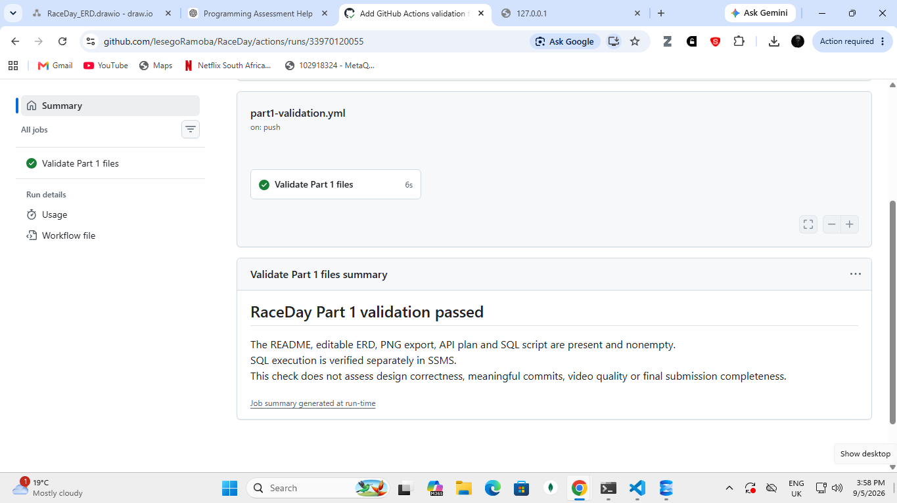

# RaceDay

## Student Details

* Name: Lesego Ramoba
* Student Number: ST10490519

## Project Overview

RaceDay is a planned web-based event management system for

running, walking, and cycling events in South Africa.

The system will support event management, participant

enrolments, event categories, and race results.

## User Roles
**Note:** Both roles share the same login page but are redirected to different dashboards after authentication.

### Organiser

* Create, view, update, and delete their events.
* Manage categories for their events.
* View enrolments for their events.
* Record and publish participant finish times and positions.

### Participant

* Register and log in.
* View and update their own profile.
* Browse events and available categories.
* Enter an event by selecting a category.
* View their own enrolments and results.

## Part 1: System Planning and Database

Part 1 includes:

* An Entity Relationship Diagram (ERD).
* An API endpoint plan.
* A SQL Server database creation and sample-data script.
* A GitHub Actions workflow to validate repository structure.

Planning documents and the SQL script are stored in /docs.

No application code is required for Part 1.

## Current Progress

The ERD, API endpoint plan and SQL database script are prepared.
The SQL script ran successfully in SSMS, and the constraint totals
matched the expected values. GitHub Actions file validation passed.

The video, final review and minimum 20 meaningful commits are
still outstanding.

## Setup Instructions

1. Clone or download this repository.
2. Ensure your SQL Server version is 2016 or higher.
3. Open SQL Server Management Studio (SSMS).
4. Connect to your SQL Server instance.
The instance used for testing was localhost\\SQLEXPRESS.
5. Open docs/RaceDay\_Database.sql.
6. With no text selected, press F5 to execute the entire script.
7. Check the Results and Messages tabs for successful execution.

The script creates RaceDay if it does not exist. It stops if
the database already contains tables, without overwriting them.
The SQL login needs permission to create databases and tables.

Expected sample totals:

| Table | Expected Rows |

|-------|---------------|

| Roles | 2 |

| Users | 4 |

| Events | 3 |

| Categories | 6 |

| Enrolments | 6 |

| Results | 2 |

Run docs/Verify\_Constraints.sql to check the constraint totals:
8 CHECK, 5 DEFAULT, 7 FOREIGN KEY, 6 PRIMARY KEY and 6 UNIQUE.

Sample users contain password hashes. Their randomly generated
passwords were discarded, so they are not usable login accounts.

## CI Validation Evidence

The workflow in .github/workflows/part1-validation.yml checks
that the required Part 1 files exist and are not empty.
It runs on pushes and pull requests and supports manual runs.

SQL execution was checked separately in SSMS.

## Video Presentation

[Watch my RaceDay Part 1 Video Presentation](https://youtu.be/zF8vHiiyGis)

---

## Part 2: RaceDay REST API

Part 2 implements a REST API using ASP.NET Core,
C#, Entity Framework Core and SQL Server.

### Technologies Used

- C# and ASP.NET Core Web API
- .NET 8
- SQL Server LocalDB
- Entity Framework Core 8
- Swagger/OpenAPI
- GitHub Actions CI/CD

### Implemented Features

The API provides CRUD operations for:

- Events
- Participants
- Registrations

Supported HTTP methods:
GET, POST, PUT and DELETE.

### Project Location

Part2/RaceDay.API

### Part 2 Setup Instructions

1. Clone or download the repository.
2. Open Part2/RaceDay.sln in Visual Studio.
3. Ensure .NET 8 SDK and SQL Server LocalDB
   are installed.
4. Restore the NuGet packages.
5. Configure DefaultConnection in
   appsettings.json for your SQL Server instance.
6. Open the Package Manager Console.
7. Select RaceDay.API as the default project.
8. Run Update-Database to apply the migrations.
9. Press F5 to run the API.
10. Open /swagger to test the endpoints.

### API Testing

The following operations were tested using Swagger:

- POST: Create an event and participant.
- GET: Retrieve events, participants and registrations.
- PUT: Update an existing event.
- DELETE: Delete an event.
- GET with an invalid ID: Returns 404 Not Found.

Successful responses included 200 OK,
201 Created and 204 No Content.

### GitHub Actions CI/CD

Workflow file:
.github/workflows/part2-build.yml

The workflow restores dependencies and builds
the RaceDay API using .NET 8.

The Part 2 GitHub Actions build passed successfully.

### Part 2 Demonstration Video

YouTube demonstration: To be added after recording.

### Development Status

The three API controllers and SQL Server database
integration are implemented and tested.

Authentication, event categories and race results
are not included in this basic Part 2 API.

